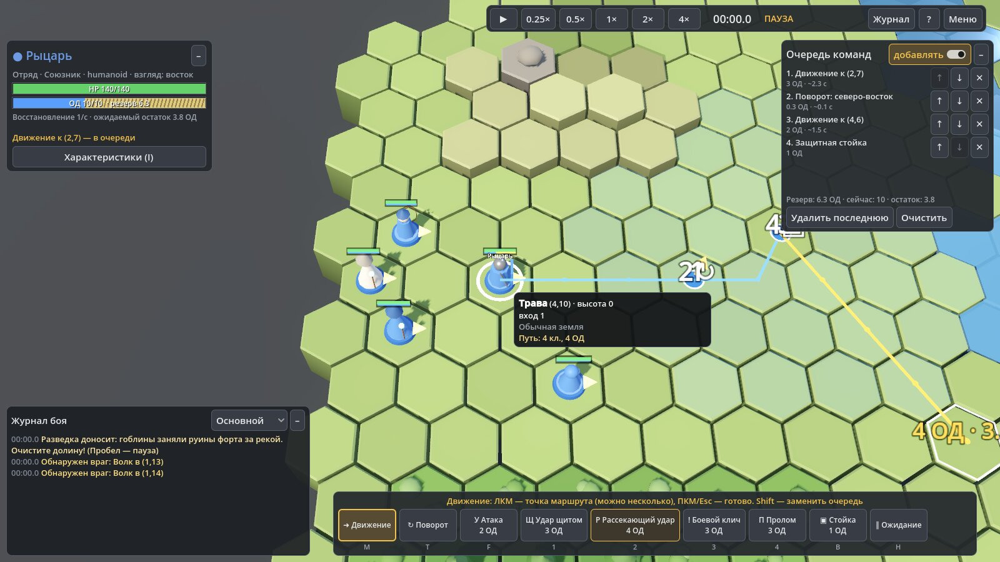
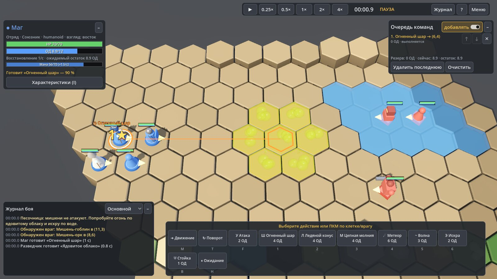
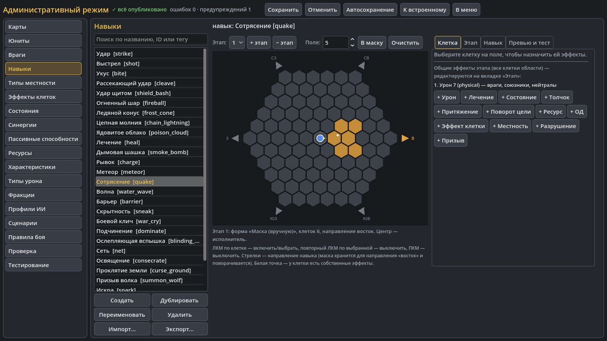

# Гекс-тактика (HexTactics) 1.0

Тактическая игра на гексагональной карте **в реальном времени с паузой**
для Windows 10/11 x64 (и Linux): отряды со взглядом и очками действия,
многоударные навыки, эффекты клеток и состояния, синергии, пассивы и
таланты, враги волнами по маршрутам, оборона баз (TD), автобой — и
**визуальный редактор всего этого без программирования**. Весь игровой
контент — данные (JSON), которые редактируются во встроенном
административном режиме, публикуются с версиями и обмениваются пакетами.



| | |
|---|---|
|  |  |
| Подготовка «Огненного шара» по ядовитому облаку (синергия → взрыв) | Редактор навыков: клик по гексам задаёт маску, 6 направлений |

**Скачать:** [страница выпуска 1.0.0](https://github.com/Natrium45634/HG/releases/tag/v1.0.0) —
`HexTactics-1.0.0-Setup.exe` (установщик), `HexTactics-1.0.0-Portable.exe`
(один файл без установки), `HexTactics-1.0.0-Linux-x64.tar.gz`.

Содержание: [1. Установка](#1-установка-и-запуск) ·
[2. Возможности](#2-возможности) · [3. Управление](#3-управление-в-бою) ·
[4. Устройство программы](#4-устройство-программы-карта-для-разработчика) ·
[5. Сборка и выпуск](#5-сборка-тесты-и-выпуск) ·
[6. Командная строка](#6-параметры-командной-строки) ·
[7. Данные](#7-где-хранятся-данные) · [8. Документация](#8-документация) ·
[9. Ограничения](#9-известные-ограничения) · [10. Версии](#10-история-версий)

---

## 1. Установка и запуск

Подробная инструкция для игрока — [installer/GUIDE_RU.txt](installer/GUIDE_RU.txt)
(она же ставится вместе с игрой как «Руководство пользователя»).

| Вариант | Что делать | Для кого |
|---|---|---|
| **Установщик** `HexTactics-1.0.0-Setup.exe` | запустить → «Далее» → игра ставится в `%LOCALAPPDATA%\Programs\HexTactics` **без прав администратора**, ярлыки в «Пуске» и на рабочем столе, удаление через «Приложения» | основной способ |
| **Один файл** `HexTactics-1.0.0-Portable.exe` | просто запустить откуда угодно (флешка, рабочий стол); первый запуск распаковывает библиотеки .NET в `%LOCALAPPDATA%\data_HexTactics_windows_x86_64` | без установки |
| **Linux** `HexTactics-1.0.0-Linux-x64.tar.gz` | распаковать, запустить `linux/HexTactics.x86_64` | Linux x64 |

* **SmartScreen.** Файлы не подписаны цифровой подписью, поэтому Windows
  при первом запуске покажет «Система Windows защитила ваш компьютер» —
  «Подробнее» → «Выполнить в любом случае». Это стандартное поведение для
  любой неподписанной программы.
* **Графика.** Нужен Vulkan или Direct3D 12; если их нет, игра сама
  переключается на OpenGL 3 (`rendering_device/fallback_to_opengl3`). Ярлык
  «Гекс-тактика (безопасный режим графики)» запускает с
  `--rendering-driver opengl3` принудительно.
* **.NET ставить не нужно** — среда выполнения входит в сборку.
* Удаление не трогает данные пользователя (раздел 7); установщик
  спрашивает, удалить ли и их.

---

## 2. Возможности

Работа шла в четыре части по отдельным ТЗ; ниже — всё, что есть в 1.0.
Итоговые отчёты частей с таблицами «требование → тест» —
[docs/STAGES.md](docs/STAGES.md).

### 2.1. Время, карта, камера
* Детерминированная симуляция **20 тиков/с**; пауза, скорости 0,25×…×16,
  шаг по одному тику; автопауза по событиям и при планировании
  (настраивается). Итог боя не зависит от FPS и скорости — бой
  воспроизводим по seed.
* Гексы — объёмные призмы с фаской и высотой; 26 типов местности (вода,
  стены, ямы, лава, high-tech поверхности…), шаблоны карт (6), метки,
  проверка достижимости. Камера «как на стол» под наклоном 35–89°,
  поворот по 60°, «вписать карту».
* Слои существ: наземные, воздушные, подземные; ямы и падение.

### 2.2. Юниты, движение, управление (часть 3)
* 6 направлений взгляда, очки действия (ОД) с резервом, A* по стоимости
  (высота, местность, эффекты, занятость), постепенное движение.
* **Стрелка взгляда**: короткий жест — поворот, длинный — маршрут по
  гексам с направлением в конце; точки маршрута с действиями (навык,
  поворот, стойка, ожидание, условие); подсветка доступных и опасных
  гексов; режимы маршрута (минимальная стоимость, безопасный, свой с
  весами); альтернативное управление «кнопка → клик» без жестов.
* Приказ по гексу врага и **радиальное меню** атак (защитный навык в
  центре, кольца от слабых к сильным), прицельные и автоматические навыки
  с правилами выбора цели и политиками потери цели.
* **Группы**: рамка, Ctrl/Alt+цифра, распределение позиций (венгерский
  алгоритм), бронирование конечных гексов, разрешение заторов, групповая
  атака по ролям, формации (7).
* Совместное нахождение на гексе по правилам, блокирование проходов.

### 2.3. Навыки и бой
* 45 навыков во встроенном контенте; подготовка, восстановление,
  перезарядка, прерывания с возвратом ОД, многоэтапные эффекты.
* **Серии ударов**: параметры каждого удара (множитель, область, шанс,
  условия И/ИЛИ/НЕ, повторы, движение), стоимость по ударам и долг,
  правила прерывания; вкладка «Серия» с пробным прогоном.
* Области `Single / Line / Cone / Sector / Radius / Ring / Cross / Chain /
  Mask / Global`, поворот по 6 направлениям, предпросмотр и
  телеграфирование.
* **Единый конвейер урона**: элементы с наследованием (10), типы урона
  (17), сопротивления/уязвимости/иммунитеты, броня, щиты, поглощение,
  отражение, криты, блок, уклонение, урон и лечение со временем; секторы
  атаки (фронт/фланги/тыл), линия видимости, туман войны, модели взгляда
  врагов и раскрытие сведений; автоатаки.

### 2.4. Эффекты клеток, состояния, синергии
* 16 эффектов клеток (огонь, яд, лёд, дым, вода, электричество…) поверх
  местности: уровни, распространение, длительность.
* 25 состояний с накоплением, порогами, спадом и флагами (оглушение,
  обездвиживание, немота, прерывание…).
* 11 синергий (огонь + газ → взрыв, искра + вода → электризация…) с
  защитой от бесконечных цепочек.

### 2.5. Пассивы, таланты, категории существ (части 3–4)
* Пассивы и таланты (25): источники, условия (здоровье, местность,
  категория, слой, расстояние, переменная сценария — день/ночь),
  срабатывания по событиям, ауры с фильтрами, «за каждого» с пределом,
  стекуемость; **единое суммирование модификаторов** с порядком расчёта
  по характеристике и разбором источников.
* **Дерево категорий** (13 во встроенном контенте) любой глубины: правила
  наследуются, переопределяются, исключаются, дополняются и условно
  меняются; основная и дополнительные категории, приоритеты, конфликты с
  объяснением, теги независимо от категорий, запреты (например,
  стандартной атаки), типы перемещения и масса.
* Примеры «без кода»: **Волк-вожак** (аура стае, «+5 % за каждого волка» с
  пределом) и **Слизь-мимик** (наследуемый запрет стандартной атаки, удар
  из засады).
* Часть 5: категория может иметь **несколько родителей** (граф без
  циклов — цикл редактор отклоняет); **группы наложения** пассивов
  (сильнейший источник, последний заменяет, первый, все); характер ИИ
  **«мирный, пока не атакуют»** отдельно от запрета **«нападать первым»**;
  у характеристик метка **«⚙ подключено к ядру»** или «без поведения»;
  **формула отталкивания** по массе и **политика столкновения** (стоп,
  цепочка, урон от удара, сдвиг в сторону); нежить уязвима к свету (+25 %).

### 2.6. ИИ и сценарии
* Профили ИИ (20): агрессия, дистанция, отступление, приоритеты целей,
  контроль, охрана базы, вожак, патруль, встреча с защитниками
  (преследование в пределах дистанции и возврат на маршрут), правила
  **«если — то — иначе»** с приоритетом, альтернативные цели при
  потерянной базе; **«только маршрут»** — враг никогда не уходит охотиться
  (часть 5).
* Враги на маршруте (часть 5): **строгость** (коридор с допуском / строго
  по гексам / только узлы), **«нет продвижения»** — стоит, ходит туда-сюда
  или без конца перестраивает путь — и **реакции по порядку**: ждать,
  уступить или обойти, перестроить путь, атаковать преграду, запасной
  маршрут, другая цель, остановиться с диагностикой; во встречной пробке
  уступает больший ID; никто не перескакивает гекс за тик.
* Сценарии (13 встроенных): стороны, цели и дерево условий
  победы/поражения, волны по времени/событию/условию, боссы с фазами,
  маркеры появления, триггеры **«событие → условия → действия»** (17
  событий, ~33 действия) с защитой от циклов, переменные окружения,
  пресеты правил.

### 2.7. TD: базы, маршруты, волны (часть 4)
* Объекты сценария из компонентов: база игрока со здоровьем и правилом
  поражения (любая/все/главная/N баз), базы спавна, точки, контрольные
  точки, сооружения, цели, зоны; несколько гексов, ориентация.
* **Маршруты рисуются мышью** протяжкой по гексам с проверкой
  проходимости вживую; граф: общие участки, пересечения, **развилки**
  (по очереди, тегам, весам, загрузке), **слияния**, **петли** с
  правилами выхода, запасные маршруты, перепроверка при изменении карты.
* Волны из **групп** у баз спавна: количество, интервалы, задержки,
  подгруппы, повторы, лимиты живых и созданных, занятая область
  появления (ждать / соседний гекс / отменить), **выбор конечной базы**
  (ближайшая достижимая, кратчайший путь, слабейшая, по весам — часть 5),
  модификаторы экземпляров,
  **уровень экземпляров**; библиотека шаблонов карточками, пресеты групп;
  **подбор состава по бюджету угрозы** с закреплением.

### 2.8. Автобой и тестирование (часть 4)
* Режимы: обычный бой, **Tower Defense**, **TD с расстановкой**
  (подготовка, бюджет, зоны, перестановка и улучшение между волнами),
  **свободный бой**, **штурм / охота**, **смешанный** (часть групп
  охотится), **сопровождение / прорыв**, **песочница**, **автотест** без
  игрока. У каждого режима — обязательные, допустимые и неиспользуемые
  части сценария; нарушения видны над свойствами и блокируют запуск.
* **Отчёт прогона**: исход, волны (по каждой — создано, уничтожено,
  дошли, урон по базе, время), базы, урон по сторонам и типам, лечение,
  щиты, навыки и пассивы, блокировки по маршрутам, эффективность
  защитников, ошибки ИИ, причины поражения.
* **Пакетные прогоны** N×seed (параллельно, результат не зависит от числа
  потоков), сравнение с предыдущим пакетом; режим «только логика»;
  остановка на событии (7 видов); сохранение в `reports/`.
* Часть 5: метрики **по каждому юниту** (урон, DPS, лечение и
  избыточное, контроль, баффы, путь, ожидание, промахи, убийства) и
  **по волнам** (запланировано / появилось / отменено, живых
  одновременно, прорывы, застревания); у пакета — доля побед с **95 %
  интервалом**, медиана, распределение прорывов, ошибки пути, худший
  прогон; экспорт **CSV**.
* **«Начать заново»** возвращает бой ровно к старту (тот же seed и
  контент); **реплей** боя (меню → «Сохранить реплей») проверяется в
  TD-сцене: совпал ли конец и что изменилось в контенте;
  **небезопасный тест** — запуск сцены с ошибками проверки, отмеченный и
  без падения приложения.

### 2.9. Оценка силы, уровень, угроза (часть 4)
* **Модель силы** без прогона боя: эффективное здоровье по типам урона,
  устойчивый урон (все удары серии, область, криты, ОД, перезарядки,
  ресурсы), дальность, мобильность, контроль, поддержка — **таблица
  вкладов** с источником каждой строки; уровень с точным значением
  («Уровень 3 (3.15)»), шкала проекта (таблица/линейная/степенная, по
  ролям, для боссов), эталон уровня 1, ранг отдельно от уровня, контексты
  (один, типичная группа, группа сценария, против категории).
* **«Подогнать под уровень»**: 10 профилей масштабирования с
  ограничениями, три варианта, роль и пропорции сохраняются, исходный
  шаблон не меняется (копия или новая версия), массово.
* **Стоимость угрозы** отдельно от уровня: базовая, на карте, против
  защитников, на маршруте. 9 правил «чрезмерно сильный?».

* Часть 5: **автосборка по бюджету** — улучшения только из пула профиля, по
  весам архетипа и seed (одинаковые шаблон, seed и версия профиля — одна
  сборка); у шаблона хранится **запись сборки** (цель, вычисленный
  уровень, seed, профиль и версия) с предупреждением о несовпадении;
  **кэш оценки** по хэшу всего, что она читает; синергия аур ограничена
  числом получателей; **калибровка** — дуэли эталонов против прогноза
  («Обзор проекта»).

### 2.10. Редактор (административный режим)
* Разделы: карты, шаблоны карт, юниты, враги, навыки, местность, слои,
  эффекты клеток, состояния, синергии, пассивы, таланты, категории
  существ, ресурсы, характеристики (38), элементы, типы урона, фракции,
  профили ИИ, формации, сценарии, **TD-сцена**, пресеты групп, ресурсы
  (модели, текстуры, звуки), визуальные эффекты, требования к ресурсам,
  правила боя (с безопасными формулами), профили масштабирования,
  пресеты правил, каталог операций, проверка, тест, **обзор проекта** и
  **результаты** (часть 5).
* **Черновик и публикация**: правки идут в черновик (автосохранение раз
  в минуту, восстановление после сбоя); «Сохранить» публикует
  транзакционно (журнал → резервная копия → атомарная запись →
  манифест), с версиями объектов, выбором «обновить ссылки / оставить
  старые экземпляры (`id@N`)» и проверкой перед публикацией.
* **Редактор карты**: кисть, высоты, заливка, линия, прямоугольник,
  пипетка, ластик, копирование и штамп (в том числе из шаблона) с
  поворотом на 60° и зеркалом, «≠» у разных значений выделенных клеток,
  слои, изменение размера с перечнем того, что пропадёт.
* **Быстрый ввод со связями**: особенность пишется словами («+25% входящего
  урона от святой магии; броня +10; иммунитет к яду») — редактор сам
  связывает слова с уже добавленными элементами, типами урона,
  характеристиками, состояниями, категориями (включая новые объекты
  черновика), показывает связи и предлагает одной кнопкой создать то,
  чего ещё нет. Есть в пассивах, талантах, категориях существ и юнитах.
  Все поля-ссылки открываются **списком с поиском** (формы слов, синонимы,
  другая раскладка, «＋ Создать»).
* **«Обзор проекта»**: все каталоги с количеством объектов, новыми и
  изменёнными в черновике, ошибками; битые ссылки и поля другой версии —
  с переходом к объекту. Файлы других версий не теряют незнакомые поля.
* **Отмена/повтор** Ctrl+Z / Ctrl+Y (одна запись на операцию), «Журнал…»
  с возвратом к точке, **точки восстановления** перед массовыми
  изменениями, **массовые изменения** выбранных шаблонов.
* Библиотека: поиск, фильтры, избранное, связи (что использует и где
  используется), версии с различиями и «Сравнить…» (пробные бои),
  импорт/экспорт объектов и пакетов `.hexpack` с зависимостями.
* **TD-сцена**: режимы «Объекты и базы», «Маршруты», «Волны»,
  «Расстановка и зоны», «Тестирование»; контекстные меню базы, маршрута и
  группы; «✓ Проверить» (полная проверка сценария с переходом к
  проблеме), «📊 Отчёт по волнам» (скачки сложности), производительность
  сцены и профиль подсистем.
* **Импорт ресурсов**: PNG/JPEG/WebP/TGA/HDR/EXR, glTF/GLB/FBX/OBJ,
  WAV/OGG/MP3 с анализом и лимитами; привязки к местности, юнитам,
  навыкам и эффектам; снаряды, маркеры анимаций, заглушки для
  отсутствующего. Часть 5:
  * необязательная **лицензия** ресурса;
  * **«Заменить файл…»** — до замены показывает объекты, которые
    используют ресурс, и что изменится; ID и настройки ресурса остаются;
  * **превью** местности, текстуры и материала на одном гексе, на группе
    соседей и на **ступенях** разной высоты.
* **Правила режима и отряд** (часть 6):
  * пресеты «Свободная RTS», «Тактический TD», «Гибрид» и свои значения
    сценария с источником каждого значения;
  * отряд игрока — размер, теги, лимиты, обязательные бойцы;
  * экран выбора отряда перед боем с причинами недоступности и пресетами;
  * **вызов бойцов за очки развёртывания** во время боя: лента отряда с
    ценой, перерывом и причиной запрета, выбор гекса и направления,
    отзыв с возвратом части очков; несколько зон развёртывания с тегами,
    фазой и приоритетом (рисуются в TD-сцене, проверяются для бойца и на
    достижимость целей, сохраняются пресетами);
  * **сохранение боя посреди схватки** и загрузка (меню боя и главное
    меню);
  * **блокирование**: дальность, приоритет и порядок целей, предел
    удержания, «прорыв навыком», «неудержим» от состояний, предупреждение
    о переполнении, связи — по запросу;
  * **модификаторы миссии и варианты сценария** («Осада — усложнённая»):
    тот же сценарий со сменой характеристик, состояний, правил, очков,
    отряда и волн; значения с источниками и проверка конфликтов до
    запуска; выбор варианта в главном меню;
  * **интерактивные объекты**: состояния с местностью и видом (ворота,
    подъёмный мост, ловушка, укрытие), взаимодействие и сигналы (рычаг),
    турели; политика для юнитов на меняющихся гексах; пресеты объектов и
    «тест на пустой карте»;
  * **граф событий** TD-сцены: правила узлами (событие → условия →
    ветвление, задержка, ворота, повтор → действия, сигналы) поверх
    обычных триггеров; типизированные связи, ошибка мгновенного цикла,
    пробная компиляция, поиск использования; в тестовом бою — отметки
    сработавших узлов, причина ложной ветки и точки останова;
  * **фазы босса как правила**: переходы «из фаз» с приоритетом и
    повтором, ничего не сбрасывается без явного правила, свой профиль у
    юнита сценария, проверка недостижимых фаз и конфликтов, вкладка «Босс
    и фазы» со схемой и прогоном фазы; **телеграфы атак** сценария с
    минимальным временем предупреждения и таймером;
  * **кампании**: задания поверх готовых сценариев и вариантов, ветвление
    и слияние, доступ по условиям (пройдено, флаг, результат не хуже
    порога), награды (сценарий, юнит, флаг, валюта, медаль) с политикой
    выдачи и ключами однократности, экран «Кампании» в главном меню,
    прогресс в данных пользователя;
  * **шкалы** (боевой дух, санити): границы и режимы Clamp / SoftCap /
    Overflow, правила по событиям боя, диапазоны → состояния (паника с
    отложенной очередью приказов), кривые → модификаторы характеристик;
    график и прогноз в редакторе, полоса шкалы в бою;
  * **дружественный огонь**: правила по видам воздействия (прямая атака,
    область, поля, объекты) на уровнях «правила боя → режим → сценарий →
    навык / поле → объект», вред отдельно от лечения и усилений,
    отношения поля при срабатывании или при создании, подсветка союзников
    в превью и подтверждение «Удар по своим», «Кого заденет» в редакторе,
    «По своим» в отчёте боя;
  * **призыв суб-юнитов**: описания «Призывы» (кто, где, сколько живёт,
    окончание, гибель призывателя, лимиты, глубина цепочек), занятые
    гексы с возвратом ресурса, простой ИИ (следовать, охранять,
    атаковать цель хозяина, держать позицию, патруль…), счётчик на HUD,
    превью расстановки в редакторе, статистика в отчёте; пример «Стая
    волков» у юнита «Зверолов»;
  * **интеграция** (6.9): переназначение клавиш боя («Настройки →
    Клавиши…»), выключатели подсистем в правилах режима (объекты,
    модификаторы, граф событий, шкалы, призывы), коды, место и
    исправление у каждой проблемы проверки с автоисправлением безопасных,
    компактная верхняя панель при большом масштабе;
  * **демоуровень «Два прохода»** (сценарий `two_passes`, кампания «Два
    прохода»): база, два маршрута, ближняя и дальняя зоны, ОР на два
    вызова, страж/стрелок/разведчик, подъёмный мост с рычагом и волна по
    мосту, вожак с двумя фазами, тяжёлый вариант.
* **Вкладки редактора юнита** (часть 5): «Характеристики», «Движение»,
  «ИИ», «Теги и категории», «Пассивы», «Навыки», «Вид», «Уровень и
  рейтинг». Рядом с любой вкладкой видны предпросмотр, оценка силы и
  правила категорий.
* **«Результаты»** (часть 5) — сохранённые пакеты автобоя, бои и
  калибровки:
  * сравнение двух результатов по смыслу показателей; разница внутри 95 %
    интервала доли побед не считается изменением;
  * регрессия калибровки по парам;
  * экспорт сравнения и сводной таблицы в CSV.

### 2.11. Диагностика
Журнал боя (основной/подробный/диагностический), панель F3 (FPS, тики,
юниты, эффекты, время подсистем), диагностика ИИ в админ-режиме,
`--selftest` сборки, профиль прогона по подсистемам.

---

## 3. Управление в бою

| Клавиша / мышь | Действие |
|---|---|
| Пробел | пауза / продолжить |
| Z / X, − / + | скорость медленнее / быстрее |
| `.` | один тик (на паузе) |
| ЛКМ по своему юниту | выбрать: стрелка взгляда и панель команд; Tab — следующий |
| Shift+ЛКМ, рамка ЛКМ | выделить несколько; приказ — групповой |
| Ctrl+1…9 / Alt+1…9 | сохранить / выбрать группу |
| Стрелка взгляда | короткий жест — поворот; длинный — маршрут, в конце — направление |
| ЛКМ на враге, R | радиальное меню навыков (защитный навык в центре) |
| M · T · F · 1–9 | движение (несколько ЛКМ — маршрут) · поворот · атака · навыки |
| B / H | защитная стойка / ожидание |
| Backspace · Delete · Shift+Delete | убрать последнюю точку · ожидающие приказы · отменить всё |
| ПКМ | быстрый приказ; во время жеста — отмена |
| Esc | шаг назад: жест → режим → выделение → меню |
| Карточка ленты отряда → ЛКМ по гексу → 1–6 / курсор → ЛКМ, Enter | вызвать бойца за очки (часть 6); Esc/ПКМ — шаг назад без затрат |
| O | отозвать выделенного бойца отряда (часть 6) |
| WASD / стрелки / средняя кнопка / край экрана | камера |
| Колесо, PgUp/PgDn · Q/E · Home · V · Ctrl+0 | зум · поворот на 60° · к юниту · вписать карту · стандартный масштаб |
| I · L · F1 · F3 | сведения · журнал · справка · диагностика |

В редакторе: **Ctrl+Z / Ctrl+Y** (Ctrl+Shift+Z) — отмена и повтор; ПКМ
по объекту, маршруту или группе волны в TD-сцене — контекстное меню.

---

## 4. Устройство программы (карта для разработчика)

### 4.1. Стек и принципы
* **C# 12 / .NET 8**, **Godot 4.4.1 .NET** (рендерер Forward+, запасной
  OpenGL 3), тесты **xUnit**. ~67 тыс. строк C#.
* **Ядро без Godot** (`src/HexTactics.Core`): гексы, контент, формулы,
  вся симуляция, автобой, оценка силы, проверки. Игра (`game/`) —
  отрисовка, ввод, интерфейс, редакторы поверх ядра. Ядро тестируется
  без движка.
* **Всё — данные**: определения (`Def`) в JSON с версией формата 5 и
  миграциями; ссылки по стабильным ID (`id` или закреплённая версия
  `id@N`). Редакторы строятся по атрибутам `[Ed]`, `[EdRef]`,
  `[EdRange]`, `[EdShowIf]` (`UI/PropertyGrid.cs`) — новое поле
  определения сразу появляется в форме и проверяется валидатором.
* **Детерминизм**: фиксированный тик, свой ГПСЧ (`SimRng`) от seed,
  упорядоченные коллекции; автобой — та же симуляция, что и бой.
* Тексты интерфейса и документация — на русском, комментарии в коде —
  на английском.

### 4.2. Структура репозитория
```
src/HexTactics.Core/        ядро (без Godot)
  Hex/                      HexCoord, направления, раскладка
  Geometry/                 геометрия гексов, вписывание камеры
  Expr/SafeExpression.cs    безопасные формулы правил (белый список)
  Content/                  контент: БД, загрузка/сохранение, библиотека, проверки, оценки
    Defs/                   все определения (UnitDef, SkillDef, ScenarioDef, RulesDef…)
  Sim/                      симуляция: Simulation и системы, ИИ, автобой, отчёт
tests/HexTactics.Tests/     xUnit: 434 теста ядра (юнит, интеграционные, нагрузочные)
game/                       проект Godot
  project.godot             версия (application/config/version), запасной OpenGL
  export_presets.cfg        Windows Desktop · Windows Single File · Linux
  content/                  встроенный контент (JSON) — 22 файла + maps/ scenarios/ map_templates/ assets/
  src/App/                  Main (запуск, аргументы, самопроверка), меню, настройки, UI-тесты
  src/Battle/               экран боя, HUD, радиальное меню, группы, расстановка, отчёт
  src/Editor/               редактор: разделы, TD-сцена, история, диалоги
  src/Render/               доска, камера, юниты, эффекты, снаряды
  src/UI/                   тема, PropertyGrid, общие элементы
installer/                  установщик Inno Setup, иконка, руководство пользователя
tools/ContentBootstrap/     однократный генератор стартового контента
docs/                       архитектура, решения, формат данных, отчёты по этапам
.github/workflows/build.yml CI: тесты → экспорт → самопроверки → установщик → выпуск
```

### 4.3. Ключевые места кода
| Что | Где |
|---|---|
| Запуск, аргументы, `--selftest`, версия | `game/src/App/Main.cs` |
| Загрузка/публикация контента, черновик, автосохранение | `game/src/App/ContentManager.cs`, `Core/Content/ContentLibrary.cs`, `ContentIO.cs` |
| База контента, таблицы, ссылки | `Core/Content/ContentDatabase.cs`, `ReferenceWalker.cs`, `ContentDependencies.cs` |
| Проверка контента | `ContentValidator.cs`, `ContentChecks.cs` (ворота публикации), `ScenarioObjectsCheck.cs`, `ScenarioChecks.cs`, `BalanceChecks.cs` |
| Миграции форматов | `ContentMigrator.cs`, [docs/DATA_FORMAT.md](docs/DATA_FORMAT.md) |
| Тик симуляции и порядок систем | `Core/Sim/Simulation.cs` (`Step`) |
| Урон | `Sim/DamagePipeline.cs`, `CombatSystem.cs`, `DefenseSystem.cs` |
| Навыки и серии | `Sim/SkillSystem.cs`, `AreaResolver.cs`, `Content/Defs/SkillDefs.cs`, `SkillSeriesDefs.cs` |
| Пассивы и модификаторы | `Sim/PassiveSystem.cs`, `ModifierMath.cs`, `Content/CategoryTree.cs` |
| ИИ | `Sim/AiSystem.cs`, `TargetSelector.cs` |
| Сценарий, волны, события | `Sim/ScenarioSystem.cs`, `ScenarioEventSystem.cs`, `StructureSystem.cs`, `RouteNavigator.cs` |
| Маршруты TD | `Content/Defs/RouteGraphDefs.cs`, `Content/RouteDrawing.cs` |
| Бюджет волн | `Content/WaveBudget.cs`, `WavePlan.cs`, `WaveReport.cs` |
| Автобой, отчёт, пакеты | `Sim/AutoBattle.cs`, `BattleReport.cs`, `PlacementSystem.cs` |
| Оценка силы, подгонка, угроза | `Content/PowerModel.cs`, `LevelFit.cs`, `ThreatModel.cs` |
| Операции редактора карты | `Content/MapOps.cs` (прямоугольник, копия, поворот, штамп, ластик, смешанные значения, размер); игра: `Editor/MapEditorPanel.cs` |
| История правок, массовые изменения | `Content/EditHistory.cs`, `MassEdit.cs`, `ChangeImpact.cs`, `VersionCompare.cs` |
| Совместимость и схемы файлов, обзор проекта | `Content/ContentCompat.cs` (поля других версий), `ContentSchema.cs`, `ProjectOverview.cs`; игра: `Editor/OverviewPanel.cs` |
| Поиск по черновику, быстрый ввод правил | `Content/ContentSearch.cs` (стеммер, синонимы, состояния), `Content/QuickRule.cs` (текст → модификаторы); игра: `UI/SearchableOption.cs`, `Editor/QuickRuleBar.cs` |
| Производительность | `Content/PerformanceBudget.cs`, `Sim/SimProfiler.cs` |
| Экран боя | `game/src/Battle/BattleScreen.cs` (ввод, горячие клавиши), `BattleHud.cs` |
| Редактор | `game/src/Editor/EditorScreen.cs` (разделы, отмена), `DefListPanel.cs` (список + форма), `TdScenePanel*.cs` |
| UI-тесты | `game/src/App/UiTestRunner.cs` (47 тестов: клики и клавиши через `Input`) |

### 4.4. Поток данных
`ContentManager` грузит встроенный пакет (`game/content` → `.pck`) или
пользовательский (`…/content`), проверяет и мигрирует. Редактор работает
с **черновиком** (копией опубликованного) через `EditorContext`
(проверка, история правок, навигация); публикация пишет пакет
транзакционно. Бой создаётся `ScenarioSystem.Create(db, scenario, seed)`;
экран боя ведёт `SimDriver` по тикам и рисует события (`SimEvent`).
Автобой — та же `Simulation` без отрисовки (`AutoBattle`).

### 4.5. Как добавить новое
* **Поле контента** — свойство с `[Ed(...)]` в нужном `Def`: форма,
  сохранение и проверка ссылок (`[EdRef]`) появляются сами; при смене
  формата — миграция в `ContentMigrator`.
* **Новая категория контента** — класс `Def`, значение `DefCategory`,
  строка в `ContentDatabase.Layout` (файл), раздел в `EditorScreen.Sections`.
* **Действие или условие сценария** — `TriggerActionDef`/`ConditionDef` +
  обработка в `ScenarioSystem`, запись в `OperationCatalog` (тест каталога
  требует описания).
* **Тест** — ядро: `tests/HexTactics.Tests` (`TestUtil.Shipped()` — встроенный
  контент); интерфейс: метод в `UiTestRunner` + `_tests.Add(("имя", Метод))`.

---

## 5. Сборка, тесты и выпуск

Нужны **.NET SDK 8** и **Godot 4.4.1 .NET (mono)** с шаблонами экспорта
`Godot_v4.4.1-stable_mono_export_templates.tpz`.

```bash
dotnet test tests/HexTactics.Tests -c Release        # 529 тестов ядра (~1,5 мин)
cd game && dotnet build && godot --path .            # игра из исходников (или F5 в редакторе Godot)

# UI-тесты (Linux без экрана — через Xvfb; ~50 мин на все 56; 120 с на тест, бой кадр за кадром — 300 с):
xvfb-run -a -s "-screen 0 1600x900x24" godot --path game --resolution 1600x900 -- --uitest=all
#   один или несколько: --uitest=editor_power_level_context_fit_threat,battle_select_and_move
#   не собирайте игру во время прогона UI-тестов — сборка заменяет загруженную DLL
#   снимки экрана из тестов: добавьте --uishots=<папка> (так сделаны docs/img/part5_*.jpg)
```

### Экспорт
```bash
mkdir -p build/windows build/windows-single build/linux
godot --headless --path game --import                                   # только свежий клон
godot --headless --path game --export-release "Windows Desktop"        # build/windows: exe + pck + data_*/
godot --headless --path game --export-release "Windows Single File"    # build/windows-single/HexTactics.exe — один файл
godot --headless --path game --export-release "Linux"                  # build/linux
build/linux/HexTactics.x86_64 --headless -- --selftest                 # SELFTEST: OK
```
«Windows Single File» = `binary_format/embed_pck` + `dotnet/embed_build_outputs`:
всё (ресурсы, сборки .NET, среда выполнения) внутри одного exe (~180 МБ).

**Иконка и версия exe** прописываются утилитой
[rcedit](https://github.com/electron/rcedit) (`application/modify_resources=true`).
В настройках редактора Godot укажите `export/windows/rcedit` (путь к
`rcedit-x64.exe`), на Linux ещё и `export/windows/wine`. Строки ресурсов —
только латиницей (через Wine кириллица портится).

### Установщик
`installer/HexTactics.iss` (Inno Setup 6, только Windows):
```
ISCC.exe /DAppVersion=1.0.0 /DSourceDir=<путь>\build\windows /DOutputDir=<путь>\dist installer\HexTactics.iss
```
Установка для текущего пользователя (в окне можно выбрать «для всех»),
русский/английский, ярлыки (игра, безопасный режим графики, руководство,
удаление), запуск после установки, при удалении — вопрос об удалении
данных пользователя. Тихая установка: `Setup.exe /VERYSILENT /CURRENTUSER`.

### CI и выпуск
[.github/workflows/build.yml](.github/workflows/build.yml) на каждый push:
1. **build** (Ubuntu): версия в `project.godot` = `APP_VERSION`, тесты
   ядра, экспорт трёх сборок с иконкой и версией (rcedit под Wine),
   самопроверка Linux, архив Linux.
2. **windows-selftest** (Windows Server): самопроверка папочной сборки и
   одиночного exe (в пустой папке), сборка установщика Inno Setup, **тихая
   установка → проверка файлов и ярлыков → самопроверка установленной
   игры → тихое удаление**.
3. **release** — при коммите с `[release]` в сообщении или запуске вручную
   (Actions → build → Run workflow): выпуск `v<APP_VERSION>` с
   установщиком, одиночным exe, архивом Linux и руководством; текст — из
   [docs/RELEASE_NOTES.md](docs/RELEASE_NOTES.md).

**Новая версия**: поменять `config/version` в `game/project.godot`,
`application/file_version`/`product_version` в `export_presets.cfg`,
`APP_VERSION` в workflow, дописать `docs/RELEASE_NOTES.md`, закоммитить с
`[release]`.

---

## 6. Параметры командной строки

Параметры движка — до `--`, параметры игры — после.

| Параметр | Назначение |
|---|---|
| `--rendering-driver opengl3` | (движок) принудительно OpenGL 3 |
| `--headless` | (движок) без окна — для самопроверки |
| `-- --selftest` | самопроверка: версия, контент без ошибок, ресурсы, 30 с симуляции каждого сценария; код 0/1 |
| `-- --uitest=all\|имя[,имя] [--uishots=<папка>]` | UI-тесты (в песочнице данных `uitest/`); с `--uishots` тесты части 5 сохраняют снимки экрана |
| `-- --auto=battle --scenario=<id> [--seed=N] [--admin] [--run=сек] [--speed=0..]` | сразу бой |
| `-- --auto=editor --tab=<раздел> [--select=<id>]` | сразу редактор; для TD: `--tdmode=routes\|waves\|placement\|test`; `--dialog=history\|wavereport\|compare`; юнит: `--powerctx=N --scroll=PX --fit=LEVEL` |
| `-- --shot=<файл.png> [--frames=N]` | снимок экрана на кадре N и выход |

---

## 7. Где хранятся данные

Windows: `%APPDATA%\Godot\app_userdata\HexTactics\`
(Linux: `~/.local/share/godot/app_userdata/HexTactics/`).

| Папка / файл | Что |
|---|---|
| `content\` | опубликованный пользовательский пакет (если есть — грузится вместо встроенного); `backups\` — копии перед перезаписью |
| `autosave\` | автосохранение черновика редактора |
| `reports\` | отчёты автотестов и пакетов (JSON, текст, CSV) |
| `replays\` | реплеи боёв (`.hexreplay`: seed, контент, действия игрока) |
| `restore_points\` | точки восстановления редактора (последние 20) |
| `editor_log.txt` | журнал изменений редактора |
| `settings.json` | настройки игрока |
| `logs\` | журналы движка |

Встроенный контент — `game/content/` (в сборке — внутри `.pck`, только
чтение). «Встроенный» в редакторе возвращает встроенный пакет
(пользовательский сохраняется копией).

---

## 8. Документация

| Документ | О чём |
|---|---|
| [docs/ARCHITECTURE.md](docs/ARCHITECTURE.md) | архитектура: слои, системы симуляции, контент, расширения частей 2–4 (§11 — модули части 4) |
| [docs/DECISIONS.md](docs/DECISIONS.md) | правила боя и значения по умолчанию (часть 1) |
| [docs/DECISIONS_2.md](docs/DECISIONS_2.md) · [_3](docs/DECISIONS_3.md) · [_4](docs/DECISIONS_4.md) · [_5](docs/DECISIONS_5.md) · [_6](docs/DECISIONS_6.md) | решения и противоречия частей 2–6 (часть 4: §55–§76; быстрый ввод — §77; аудит части 5 — §78–§83; этапы части 5 — §84–§89; итоговый отчёт части 5 — §90; аудит и план части 6 — §91–§95) |
| [docs/DATA_FORMAT.md](docs/DATA_FORMAT.md) | формат файлов контента, версии, миграции |
| [docs/schema](docs/schema) | JSON Schema каждого файла контента (генерируются из определений, тест сверяет) |
| [docs/STAGES.md](docs/STAGES.md) | отчёты по всем этапам и итоговые отчёты частей (требования ТЗ → тесты) |
| [docs/reports](docs/reports) | экспортированные отчёты: пакет из 100 прогонов TD-сценария, калибровка оценки силы |
| [docs/RELEASE_NOTES.md](docs/RELEASE_NOTES.md) | что в выпуске |
| [installer/GUIDE_RU.txt](installer/GUIDE_RU.txt) | руководство пользователя |

---

## 9. Известные ограничения

* Сборки не подписаны (предупреждение SmartScreen при первом запуске).
* Проверено: самопроверка и установка/удаление — на Windows Server (CI),
  UI-тесты — на Linux и под Wine; запуск с окном на настоящей Windows
  10/11 и рендерер Vulkan/D3D12 на Windows-драйверах автоматически не
  проверяются.
* Юнит занимает один гекс (размер влияет на узкие места); экипировки нет
  (только подпись источника); поворот — по 6 направлениям.
* Маршруты: узел не перетаскивается мышью (ветку перерисовывают); узлы не
  создаются кликом на пустом месте.
* Оценка силы — аналитическая, откалибрована на встроенных шаблонах;
  окончательная проверка баланса — прогоны автобоя. Калибровка (часть 5)
  показывает, где прогноз ошибается, но веса автор правит сам.
* Поворот UV работает только у текстуры верха гекса: рендерер материалов
  его не поддерживает, и редактор пишет об этом у поля.
* Граф категорий в редакторе показан деревом и цепочкой предков, а не
  рисунком.
* Отмена/повтор — в пределах сеанса редактора (200 операций).
* UI-тесты в CI не запускаются (нужен графический сервер).

---

## 10. История версий

**1.0.0** — первый выпуск: части 1–4 ТЗ целиком (бой, редакторы,
библиотека контента и пакеты, управление и навыки части 3, TD-редактор,
автобой, оценка силы, инструменты проекта); установщик Windows,
одиночный exe, сборка Linux. Подробно — [docs/RELEASE_NOTES.md](docs/RELEASE_NOTES.md).

## Шрифты и лицензии

В сборку входит шрифт DejaVu Sans (`game/fonts/`, лицензия Bitstream Vera —
`game/fonts/DejaVu-LICENSE.txt`) как резервный для символов интерфейса.
Движок — [Godot Engine](https://godotengine.org) (MIT).
